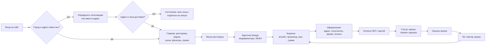

# Пользовательский путь и структура

## Основной сценарий

## Карта экранов

| Раздел | Экраны и состояния | В прототипе |
|---|---|---|
| Адрес | Автоопределение, ручной ввод с подсказками, выбор города, вне зоны доставки | ✓ |
| Главная | Гость (hero с адресом), с адресом, скелетон загрузки, промо, кухни, быстрые фильтры, сортировка, поиск по ресторанам и блюдам, «ничего не нашли» | ✓ |
| Ресторан | Шапка с фактами (рейтинг, время, доставка, мин. сумма), липкие категории со scrollspy, акция, ресторан закрыт / предзаказ, боковая корзина (десктоп), плавающая корзина (мобайл) | ✓ |
| Блюдо | Bottom sheet (мобайл) / модальное окно (десктоп), размеры и добавки, КБЖУ, количество | ✓ |
| Корзина | Позиции со степпером, прогресс до бесплатной доставки, апсейл, приборы, промокод (успех / ошибка / другой ресторан), мин. сумма не набрана, пустая, конфликт двух ресторанов | ✓ |
| Оформление | Адрес и детали (кв., подъезд, этаж, домофон), «оставить у двери», получатель, ASAP / слот, способ оплаты, сдача, валидация | ✓ |
| Заказ | 4 статуса, ETA, карта с курьером, звонок, отмена на первом шаге, оценка и теги отзыва | ✓ |
| Вход | Телефон → код из СМС, ошибки | ✓ |
| Личный кабинет | Заказы с повтором, адреса, избранное, способы оплаты, уведомления | ✓ |
| Следующая итерация | Страница города (SEO), подборки, магазины, чат поддержки, ошибка оплаты, нет сети, 404 | частично (404) |

## Решения по ключевым точкам трения

1. **Адрес до каталога.** Без адреса нельзя честно показать время и стоимость доставки. Гость видит каталог, но модалка адреса открывается сразу и закрывается одним тапом.
2. **Одна корзина = один ресторан.** При попытке добавить блюдо из другого ресторана показываем диалог с понятным выбором, без молчаливой очистки.
3. **Деньги видны заранее.** Стоимость доставки, порог бесплатной доставки и мин. сумма есть на карточке, в шапке ресторана и в корзине. Кнопка оформления блокируется с объяснением, сколько не хватает.
4. **Предзаказ вместо тупика.** Закрытый ресторан не прячем: показываем время открытия и предлагаем доставку ко времени.
5. **Ошибки говорят, что делать.** «Нужен номер из 11 цифр, например +7 900 000-00-00» вместо «Неверный формат».
6. **Повтор заказа.** Один тап в ЛК, с защитой от смешения корзин.

## Адаптивность

| Ширина | Сетка | Навигация | Корзина |
|---|---|---|---|
| < 560 | 4 колонки, поля 16 | Нижний таб-бар | Плавающая кнопка над таб-баром |
| 560–1023 | 8 колонок | Нижний таб-бар | Плавающая кнопка, модалки по центру с 720 px |
| ≥ 1024 | 12 колонок, контейнер 1240, поля 32 | Шапка с поиском | Липкая боковая корзина на странице ресторана |
